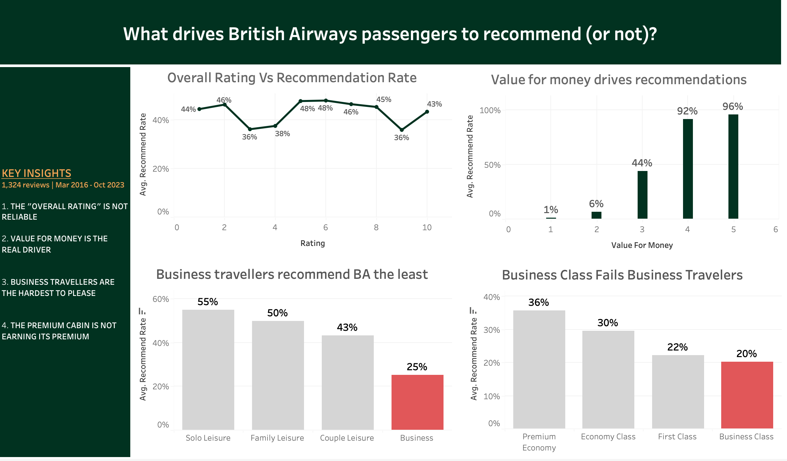
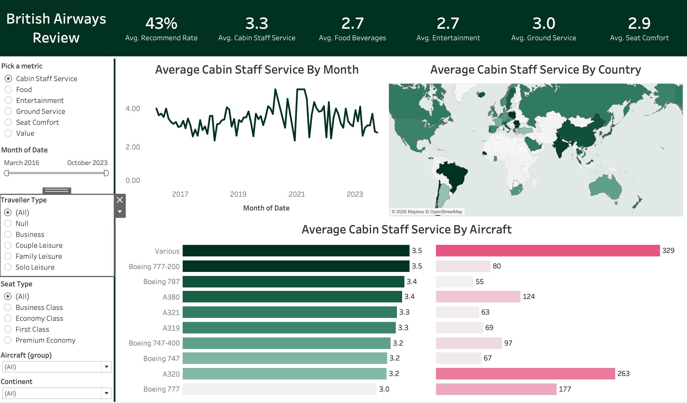

# British Airways Passenger Experience Analysis | Tableau

**What makes passengers recommend British Airways, and what puts them off?**

I analysed 1,324 passenger reviews from March 2016 to October 2023 to understand what shapes the British Airways customer experience. I built two Tableau dashboards: one for exploring passenger ratings and another for presenting the key findings.

The analysis uncovered a strong relationship between value-for-money ratings and recommendations, as well as a clear satisfaction gap among business travellers.

**[View the dashboards on Tableau Public](https://public.tableau.com/app/profile/sneha.shrivastava5964/vizzes)** 



---

## The Business Problem

Passenger satisfaction can vary significantly depending on the cabin, type of traveller, aircraft and service experience. Looking at an overall rating alone doesn't reveal where the problems lie or which areas deserve attention first.

I focused on three questions:

- What separates passengers who recommend BA from those who don't?
- Which traveller groups are least satisfied?
- Where could BA focus its improvement efforts?

## What I Found

### 1. Value for money has the strongest relationship with recommendations

Passengers who rated value for money 1–2 recommended BA only 1–6% of the time. Among those who gave it a rating of 4–5, the recommendation rate rose to 92–96%.

This makes value for money an important area to investigate when looking at passenger loyalty.

### 2. Business travellers are less likely to recommend BA

Only 25% of business travellers recommended the airline, compared with 43–55% across couples, families and solo leisure travellers.

This suggests that BA's experience may not be meeting business travellers' expectations as consistently as it does those of other passenger groups.

### 3. The gap is particularly noticeable in Business Class

Among business travellers flying Business Class, just 20% recommended BA. For leisure travellers in the same cabin, the rate was 50–69%.

The difference raises questions about whether the Business Class experience delivers enough value for passengers travelling for work.

### 4. Business travellers were less likely to recommend BA in Business Class than in Economy

Business travellers recommended BA at a rate of 20% in Business Class, compared with 30% in Economy.

First Class business travellers (n=18) and Premium Economy business travellers (n=28) had much smaller samples, so I treated those results cautiously rather than drawing firm conclusions.



## What Could BA Do With These Findings?

The results point to three areas worth investigating:

- **Review the Business Class value proposition.** Examine pricing, onboard amenities and service expectations to understand why business travellers may not feel they are getting sufficient value.
- **Look more closely at corporate travellers.** Break down their feedback by route, cabin and service category to identify specific pain points and opportunities to improve their experience.
- **Monitor recommendations over time.** Track the recommendation rate by traveller type and cabin each month to see whether changes lead to improvements, rather than relying on a single overall score.

These are recommendations for further investigation, not proof of what causes dissatisfaction.

## Getting the Data Right

Before interpreting the results, I checked whether the underlying data and KPIs could be trusted. Two issues stood out.

**Unrated scores were pulling down the entertainment average.**

Some service ratings used `-1` to represent reviews where a passenger hadn't rated that category. This affected 457 of the 1,324 entertainment scores (34.5%) and 7.6% of food ratings.

Treating `-1` as a genuine score brought the entertainment average down to 1.4. I created Tableau calculated fields to treat these values as null, bringing the entertainment average to 2.7.

**The overall rating wasn't telling a reliable story.**

The dataset's overall `rating` column didn't show a clear relationship with whether passengers recommended BA. The recommendation rate remained between 36% and 48% across scores from 1 to 10.

Rather than relying on this field as a headline measure, I used **Recommend Rate (43%)** as the main KPI, which directly reflects the outcome being investigated.

I also checked sample sizes before comparing passenger groups, particularly where smaller groups could make the results less reliable.

## The Dashboards

### Explore Dashboard

An interactive dashboard for investigating passenger ratings across six service categories:

- Cabin staff service
- Food and beverages
- Entertainment
- Ground service
- Seat comfort
- Value for money

Users can filter by date range, traveller type, cabin class, aircraft and continent. Selecting elements on the map, trend line or aircraft chart allows related views to be explored together.

### Key Insights Dashboard

A summary dashboard that brings the main findings together through four charts and a written takeaway panel. It focuses on the factors associated with recommendations, differences between passenger segments and areas worth investigating further.

## Tools & Techniques

- **Tableau Public:** Dashboard development and data visualization
- **Calculated fields:** Handling unrated values and creating reliable rating metrics
- **Parameters:** Switching between service metrics
- **Dashboard actions and filters:** Exploring relationships across charts and passenger segments
- **Data validation:** Checking rating distributions, KPI reliability and sample sizes

**Data files:** `ba_reviews.csv` (1,324 reviews) and `Countries.csv` (country-to-continent mapping).

## Limitations

A few things are important to keep in mind when interpreting these findings:

- **Reviews are self-selected.** The results describe patterns within the available reviews and do not necessarily represent all BA passengers. Associations do not establish causation.
- **The data is geographically concentrated.** Around two-thirds of reviewers are UK-based, so comparisons involving countries with fewer reviews should be treated cautiously.
- **Some aircraft have limited entertainment data.** The A319, A320 and A321 have many unrated entertainment scores, consistent with differences in their onboard entertainment setups. Their entertainment averages should therefore be interpreted with caution.

## My Contribution

This project began with a public Tableau tutorial, which provided the base dashboard structure, including the metric selector, filters, map, trend line and aircraft chart.

I extended that foundation through my own analysis:

- Investigated the `-1` values and corrected the entertainment KPI.
- Evaluated the overall rating field and introduced Recommend Rate as the headline KPI.
- Analysed how recommendations varied with value-for-money ratings, traveller types and cabin classes.
- Built a separate Key Insights dashboard to communicate the findings.
- Developed the recommendations and documented the limitations of the analysis.

The focus was not just on building charts, but on checking the data, questioning the metrics and using the results to answer a business question.

## Repository Structure

```text
├── README.md
├── data/
│   ├── ba_reviews.csv
│   └── Countries.csv
└── images/
    ├── insights_dashboard.png
    └── exploratory_dashboard.png
```
